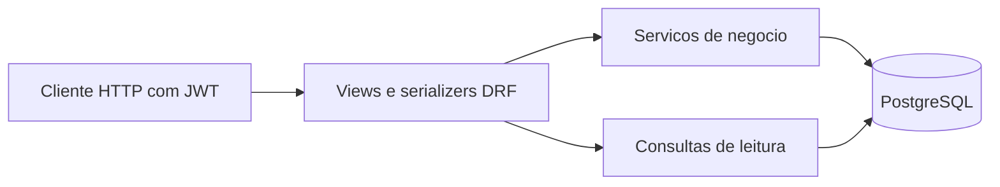
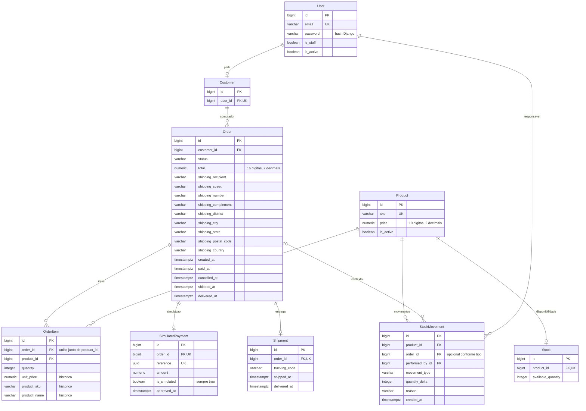
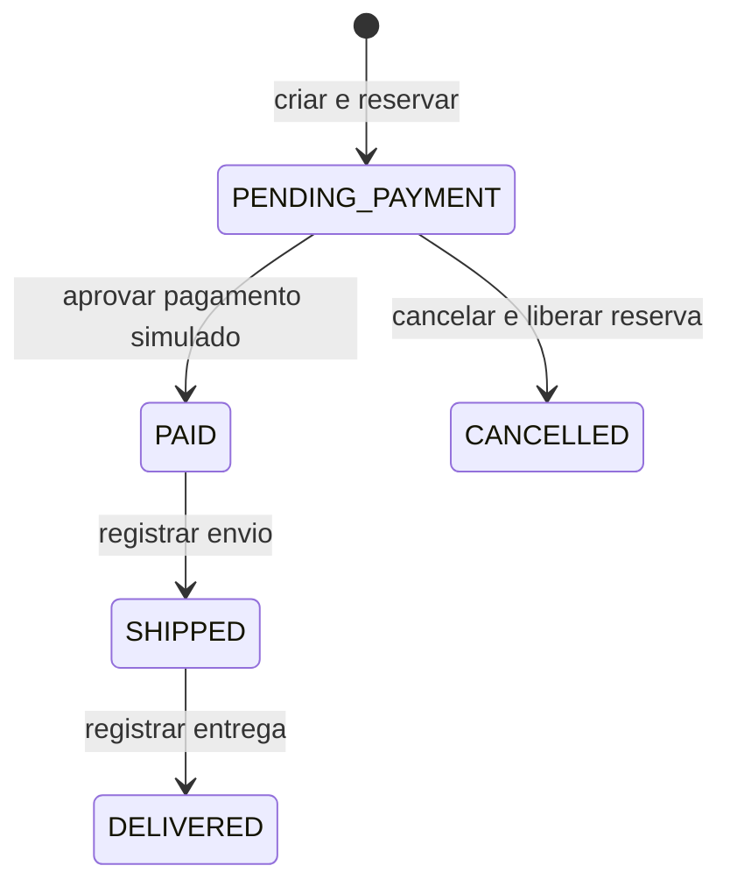

# Modelo e decisões transacionais

A aplicação é um monólito Django dividido por domínio. Essa divisão mantém autenticação, catálogo, estoque, pedidos e relatórios próximos de suas regras, sem acrescentar uma camada genérica sobre o ORM.

| Camada | Responsabilidade |
| --- | --- |
| `accounts` | Cadastro, perfil, JWT e papéis atuais |
| `catalog`, `inventory` | Produtos, disponibilidade e movimentos auditáveis |
| `orders` | Criação, reservas, histórico, pagamento simulado e entrega |
| `reports` | Indicadores e períodos, com autorização administrativa |
| `common` | Validação, campos estritos, paginação, erros e documentação compartilhada |

Serializers verificam formato e campos permitidos. Views traduzem a operação em HTTP. Serviços também validam entrada e papel atual, pois podem ser chamados fora da API. Os modelos e o PostgreSQL impõem restrições locais de integridade.

## Diagrama entidade-relacionamento atual

O diagrama destaca os campos e relações do domínio, sem listar todos os atributos de cada modelo. O objeto JSON `shipping_address` da API é persistido nas nove colunas de endereço do pedido. A [modelagem detalhada](etapa-02-modelagem.md) lista os campos e restrições definidos na Etapa 2; os modelos/migrations são a referência executável atual.

As cardinalidades representam a garantia física: uma relação única permite **no máximo um** estoque por produto, pagamento por pedido e remessa por pedido. A existência de estoque e de itens é responsabilidade dos serviços transacionais. Tabelas de grupos/permissões do Django foram omitidas do desenho do domínio.

## Estados e estoque

O saldo disponível diminui **na criação**, antes do pagamento. Pagamento, envio e entrega não descontam estoque novamente. Cancelar um pendente devolve exatamente as unidades reservadas; não há cancelamento de pago/enviado/entregue, estorno, devolução ou transição reversa nesta versão.

Dinheiro usa `Decimal` no Python e `numeric` no PostgreSQL. Quantidades são inteiros estritos: booleanos e números fracionários são rejeitados. Cada item guarda preço, SKU e nome do momento da compra; mudar o catálogo não reescreve pedidos antigos. O endereço também é uma cópia histórica.

## Por que as transações e os bloqueios são necessários

Uma transação faz pedido, itens, saldo e movimentos confirmarem juntos. Se a gravação de um movimento falhar depois de alterar o saldo, o rollback desfaz a operação inteira. Essa propriedade é conferida por injeção de falha depois das escritas.

A transação sozinha não resolve duas compras que leem o mesmo saldo ao mesmo tempo. Na criação, `select_for_update()` bloqueia produtos por ID e depois seus estoques na mesma ordem. A segunda compra aguarda; quando prossegue, lê o saldo confirmado pela primeira e decide com esse valor. Ordenar IDs também reduz a possibilidade de operações com vários produtos adquirirem os mesmos bloqueios em ordens opostas.

Nas transições, o serviço bloqueia primeiro o pedido e confere a coerência dos itens, reservas/liberações, pagamento e remessa. O cancelamento bloqueia em seguida produtos e estoques na ordem comum. Pagamento e cancelamento concorrentes não podem confirmar juntos: depois da espera, a segunda operação observa o novo estado e rejeita a transição incompatível.

Repetir pagamento/cancelamento/envio/entrega já concluídos preserva registros e datas quando a repetição é válida. Repetir envio exige o mesmo código. Repetir **criação** é outra compra, sujeita ao saldo; não existe chave de idempotência para o POST de criação.

As [decisões das transições](etapa-06-transicoes.md) e a [matriz de testes](etapa-10-testes-ci.md) detalham cenários, rollback e bloqueios observados. A concorrência foi testada no PostgreSQL com conexões independentes; não se infere essa garantia de testes em SQLite.

## Garantias locais e entre tabelas

O banco verifica FKs, unicidades, sinais de movimentos, quantidades, moeda, valores finitos/positivos e combinações/ordem das datas do próprio registro. `PROTECT` e FKs preservam referências históricas. Não há API para editar ou apagar itens, pagamentos, remessas ou movimentos históricos.

Igualdade entre total e itens, pagamento e pedido, saldo e razão de movimentos e as transições dependem dos serviços e da conferência do histórico. Não criei CHECKs que consultam outras tabelas. Escritas administrativas arbitrárias por SQL podem contornar o fluxo e causar inconsistência; a API não é um mecanismo de reparo automático.

## Relatórios e leituras

Faturamento soma **pagamentos simulados aprovados**, pela aprovação, em estados PAID/SHIPPED/DELIVERED. Não representa cobrança real nem apuração contábil/fiscal. Relatórios usam São Paulo e intervalo de datas com início inclusivo/fim exclusivo. Vendas por produto usam preço histórico dos itens.

Total, contagem e série do faturamento derivam do mesmo agregado SQL. Não há snapshot global entre endpoints ou páginas sob leitura concorrente. Listas de pedidos usam junções para relações unitárias e prefetch para itens; a contagem de consultas fica constante ao aumentar a página.

A Etapa 9 acrescentou apenas `payment_approved_at_idx` e `order_pending_created_idx`, justificados por medições. PKs, FKs e unicidades já forneciam outros índices. Veja [planos, números e custos](etapa-09-desempenho.md), incluindo a consulta anual sem ganho demonstrável.
