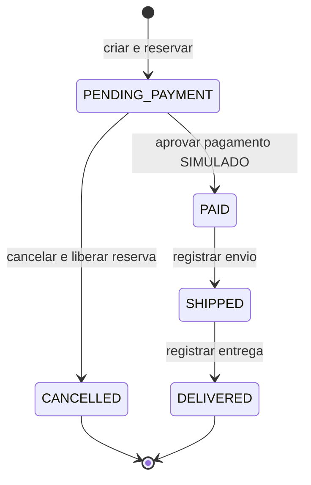
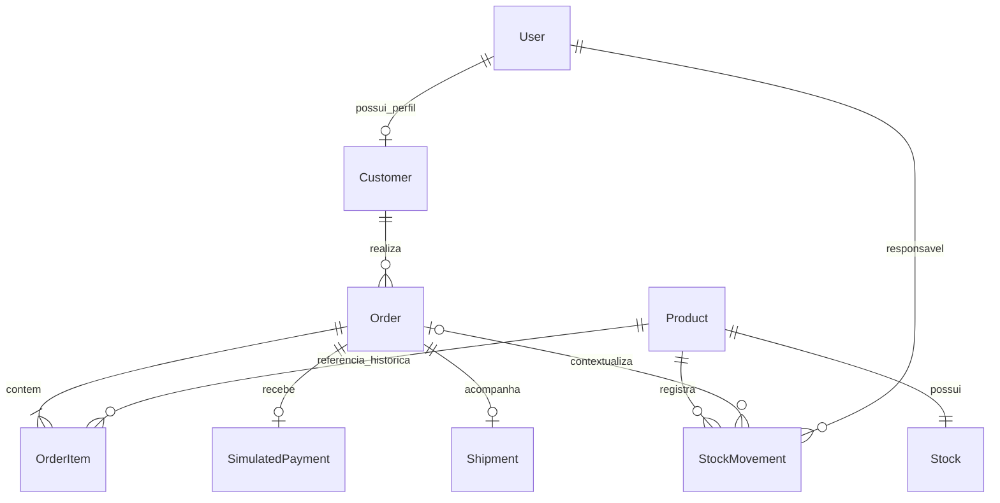

# Etapa 1 — Domínio, fluxo dos pedidos e proposta de modelagem

## 1. Base e alcance desta entrega

O documento de origem, `Prompt_Projeto_Loja_Pedidos_Estoque.pdf`, foi lido integralmente, nas sete páginas. Esta entrega apresenta as decisões antes da implementação. Nenhum modelo, migration ou endpoint foi criado.

As regras obrigatórias vêm do PDF e do pedido do usuário. Decisões que completam detalhes não definidos no PDF estão identificadas como propostas; elas não devem ser confundidas com exigências textuais do documento.

Objetivo: uma única loja fictícia, com um único estoque por produto, capaz de reservar unidades, registrar pagamentos simulados e acompanhar pedidos até a entrega. A prioridade é preservar dados corretos mesmo quando duas requisições chegam ao mesmo tempo.

## 2. Dependências de execução e decisões complementares

### 2.1 Ajustes de sequência propostos

**Etapas 2 e 3:** o critério da Etapa 2 exige migrations e restrições funcionando no PostgreSQL, mas a configuração do ambiente está na Etapa 3. Não é uma contradição nas regras de negócio; é uma dependência operacional invertida. Proposta: antecipar apenas a seleção de versões e o ambiente mínimo com PostgreSQL necessário para verificar a Etapa 2. Na Etapa 3, completar a execução reproduzível com aplicação, Compose, configurações e geração de dados. A parte afetada ainda não foi implementada.

**Testes na Etapa 10:** a regra geral exige verificar cada entrega. Portanto, os testes serão criados junto das funcionalidades; a Etapa 10 consolida a cobertura dos riscos e configura a integração contínua. Não será necessário esperar essa etapa para testar regras, permissões ou transações.

**Dependências da autenticação:** a API de cliente da Etapa 4 depende de usuário e cliente da Etapa 2. A autenticação poderá ser verificada nessa etapa; testes de acesso a pedidos serão acrescentados quando esses endpoints existirem. O critério completo de permissões sobre pedidos só poderá ser encerrado então.

### 2.2 Propostas para fechar detalhes em aberto

| Tema não detalhado no PDF | Proposta para a primeira versão |
| --- | --- |
| Moeda | BRL, duas casas decimais; preço de produto estritamente positivo. Não há conversão de moedas nem produtos gratuitos nesta versão. |
| Total | Soma de quantidade × preço unitário histórico de cada item. Frete, impostos adicionais e descontos não entram no cálculo desta versão. |
| Alterar pedido | Produtos, quantidades e endereço ficam imutáveis após a criação. Para corrigir um pedido pendente, o cliente o cancela e cria outro, sujeito à disponibilidade e aos preços vigentes. |
| Endereço | Exigir endereço de entrega na criação e guardar uma cópia estruturada no pedido. Agenda de endereços fica fora do escopo inicial, pois o PDF a torna opcional. |
| Cancelamento administrativo | Apenas o cliente dono pode cancelar. O perfil administrador descrito no PDF não recebe essa operação. Ampliá-la exigiria uma decisão explícita futura. |
| Falha ou recusa de pagamento | Não gera registro aprovado e mantém o pedido pendente. A versão inicial oferece confirmação administrativa de aprovação simulada; não simula operadoras nem armazena cartão. |
| Rastreamento | Código opcional e fictício, informado no envio. Depois do envio, não haverá edição por uma operação separada nesta versão. |
| Repetições | Pagamento e cancelamento são idempotentes; propõe-se a mesma proteção para envio e entrega, preservando registros e datas originais. |
| Produto inativado depois da compra | Não permite novas compras, mas o pedido já reservado pode seguir o fluxo normal ou ser cancelado enquanto pendente. |
| Fuso | Armazenar instantes com fuso, em UTC; apresentar e agrupar relatórios por `America/Sao_Paulo`. |

São escolhas de escopo para permitir implementação e testes sem regras implícitas. Nenhuma integração de cobrança real será adicionada.

## 3. Regras do negócio

1. Cada produto tem SKU único, preço atual, indicador de ativo e exatamente um registro de estoque mantido pela aplicação.
2. Quantidades de itens são inteiras positivas. O estoque disponível é inteiro e nunca negativo.
3. Um pedido tem pelo menos um item e não repete o mesmo produto. Produtos inexistentes, inativos ou sem unidades suficientes impedem a compra inteira.
4. O cliente autenticado cria pedidos apenas para si. O servidor define dono, preços, total, status e datas. Campos protegidos enviados na criação serão rejeitados, evitando adulteração silenciosa.
5. A criação bem-sucedida produz um pedido `PENDING_PAYMENT` e reduz o estoque disponível na mesma transação. Isso é a reserva.
6. Todos os itens usam preços lidos no servidor. Cada item guarda cópias do preço, SKU e nome da compra. Alterações posteriores no catálogo não reescrevem o histórico.
7. O pagamento é sempre **SIMULADO — SEM COBRANÇA REAL**. Somente o administrador pode confirmá-lo; o valor vem do total do pedido. A aprovação cria um registro único e muda o status para `PAID` sem alterar estoque.
8. Só o dono pode cancelar um pedido `PENDING_PAYMENT`. O cancelamento devolve cada unidade reservada, registra a liberação e muda o status para `CANCELLED`, tudo na mesma transação.
9. Pedidos `PAID`, `SHIPPED` e `DELIVERED` não podem ser cancelados. `CANCELLED` e `DELIVERED` são estados finais.
10. Apenas pedidos pagos podem ser enviados; apenas enviados podem ser entregues. O administrador executa essas operações.
11. Repetir uma operação já concluída não duplica pagamento, entrega ou movimento de liberação e não substitui as datas originais. Permissões continuam sendo exigidas nas repetições.
12. Não há expiração automática. Uma reserva pendente permanece ocupando unidades até pagamento ou cancelamento. Listar pedidos antigos ajuda a visualizar essa limitação, sem cancelá-los automaticamente.
13. Entradas e ajustes são administrativos, exigem justificativa e responsável e mantêm saldo não negativo. A aplicação não permite editar o saldo diretamente sem registrar o movimento correspondente.
14. Produtos e usuários necessários ao histórico têm exclusão protegida. A operação normal usa inativação; os registros de auditoria não terão endpoints de edição ou exclusão.

**Reserva não exige dois descontos.** Se há 10 unidades e um pedido reserva 3, o disponível passa a 7. Pagar, enviar e entregar mantêm 7. Cancelar antes do pagamento devolve as 3 e restaura 10. Não haverá um segundo campo de saldo reservado nesta versão: o compromisso está representado pelos itens e pelo estado dos pedidos.

## 4. Perfis e limites de acesso

| Operação | Cliente autenticado | Administrador |
| --- | --- | --- |
| Consultar catálogo ativo | Sim | Sim |
| Consultar produtos inativos e gerenciar catálogo | Não | Sim |
| Criar pedido | Para si | Não incluído no papel administrativo |
| Consultar pedidos | Somente os próprios | Todos |
| Cancelar pedido pendente | Somente o próprio | Não incluído no papel administrativo |
| Confirmar pagamento simulado | Não | Sim |
| Registrar envio e entrega | Não | Sim |
| Registrar entrada ou ajuste de estoque | Não | Sim |
| Consultar relatórios de negócio e auditoria de estoque | Não | Sim |
| Consultar e atualizar perfil | Somente os próprios dados permitidos | Próprios dados permitidos |

Proposta: o catálogo também exige autenticação na primeira versão. Cadastro e obtenção de token são as entradas públicas necessárias. A criação de administradores será uma operação controlada do projeto; cadastro e atualização de cliente nunca aceitam privilégios administrativos.

Credenciais e senhas serão gerenciadas pelo Django. A API não retornará senhas ou hashes. JWT identifica o usuário; a autorização ainda precisa verificar o perfil e a propriedade de cada objeto. Saber um identificador de pedido não concede acesso a ele.

## 5. Máquina de estados e efeitos

### 5.1 Transições de negócio

| Origem | Destino | Operação e responsável | Efeito no estoque | Efeito no pagamento | Efeito na entrega |
| --- | --- | --- | --- | --- | --- |
| Pedido inexistente | `PENDING_PAYMENT` | Cliente cria para si | Reduz disponível por item e registra `RESERVATION` | Nenhum registro | Nenhum registro |
| `PENDING_PAYMENT` | `PAID` | Administrador confirma simulação | Nenhum | Cria um `SimulatedPayment`, com total do pedido, referência única e data | Nenhum registro |
| `PENDING_PAYMENT` | `CANCELLED` | Cliente dono cancela | Devolve cada quantidade e registra `RELEASE` | Deve continuar inexistente | Deve continuar inexistente |
| `PAID` | `SHIPPED` | Administrador registra envio | Nenhum | Preserva registro aprovado | Cria uma `Shipment` com data de envio e rastreamento opcional |
| `SHIPPED` | `DELIVERED` | Administrador registra entrega | Nenhum | Preserva registro aprovado | Atualiza a entrega existente com a data de recebimento |

Todas as outras mudanças de estado são proibidas. O cliente não envia um status para aplicá-lo diretamente. Cada ação de negócio controla sua própria transição e seus efeitos.

### 5.2 Repetições e conflitos

Idempotência significa que repetir a mesma intenção não repete seus efeitos. Uma repetição válida não é uma nova transição.

| Comando | Estado na repetição | Comportamento proposto |
| --- | --- | --- |
| Confirmar pagamento simulado | `PAID`, `SHIPPED` ou `DELIVERED`, com pagamento consistente | Retornar o mesmo pagamento, mantendo referência, valor, aprovação e estado atual |
| Confirmar pagamento simulado | `CANCELLED` | Rejeitar, sem efeitos |
| Cancelar | `CANCELLED`, pelo dono | Retornar o pedido cancelado; não liberar novamente |
| Cancelar | `PAID`, `SHIPPED` ou `DELIVERED` | Rejeitar, sem efeitos |
| Enviar | `SHIPPED` ou `DELIVERED`, com os mesmos dados de rastreamento | Retornar a entrega existente; preservar datas e estado atual |
| Enviar | Já enviado, com rastreamento diferente | Rejeitar conflito; não sobrescrever o registro |
| Entregar | `DELIVERED`, com entrega consistente | Retornar a entrega existente; preservar data original |
| Enviar ou entregar | Estado anterior ao exigido ou `CANCELLED` | Rejeitar, sem efeitos |

Se estado e registros estiverem incompatíveis, a operação deve sinalizar falha de integridade, sem tentar fabricar ou consertar histórico silenciosamente. Repetições não dispensam essa conferência.

A criação de pedidos não ganha idempotência automaticamente: duas criações válidas podem produzir dois pedidos. Uma chave de idempotência para criação seria uma evolução separada, fora desta primeira versão.

## 6. Proposta de entidades e relacionamentos

Este é um diagrama conceitual. O diagrama detalhado com campos, tipos e nomes de restrições será entregue na Etapa 2 antes das migrations finais.

| Entidade | Conteúdo e decisão principal |
| --- | --- |
| `User` | Modelo customizado definido desde o início, baseado nos mecanismos de autenticação do Django. Proposta: email único como login e nome; privilégios controlados no servidor. |
| `Customer` | Perfil vinculado de forma única ao usuário, com contato mínimo, como telefone opcional. Cadastro de cliente cria usuário e perfil juntos. Um administrador não precisa de perfil de cliente. |
| `Product` | Identificador, SKU único, nome, descrição, preço atual, ativo, criação e atualização. Inativar preserva referências antigas. |
| `Stock` | Relação única com produto e `available_quantity`, inteiro não negativo. Produto novo começa com saldo zero; uma entrada documentada abastece o estoque. |
| `Order` | Cliente, status, total calculado, moeda BRL, cópia estruturada do endereço, criação, atualização e datas de pagamento, cancelamento, envio e entrega. |
| `OrderItem` | Pedido, produto, quantidade, `unit_price`, `product_sku` e `product_name` históricos. Um produto aparece no máximo uma vez por pedido. Subtotal é quantidade × preço histórico. |
| `SimulatedPayment` | Relação única com pedido, valor, referência única, `approved_at` e `is_simulated=True` obrigatório. Representa exclusivamente aprovação simulada. Não inclui cartão, dados bancários ou credenciais de provedores. |
| `Shipment` | Relação única com pedido, rastreamento fictício opcional, `shipped_at` e `delivered_at`. Só nasce no envio; entrega atualiza esse registro. |
| `StockMovement` | Produto, tipo, variação assinada `quantity_delta`, pedido quando aplicável, usuário responsável, data e justificativa. Representa histórico da mudança de disponibilidade. |

O endereço do pedido guardará, como proposta, destinatário, logradouro, número, complemento opcional, bairro, cidade, estado e CEP; país fixo Brasil nesta versão. Não dependerá de um endereço mutável do perfil. Dados de demonstração usarão nomes e contatos fictícios, como emails em `example.com`.

As datas de status no pedido facilitam consultas, mas repetem informações de pagamento e entrega. Cada serviço deverá atualizar essas datas e os registros relacionados juntos, com o mesmo instante da operação.

### 6.1 Convenção para movimentações

| Tipo no código | Sinal de `quantity_delta` | Pedido associado | Exemplo |
| --- | --- | --- | --- |
| `ENTRY` | Positivo | Não | Compra fictícia de reposição: `+10` |
| `ADJUSTMENT` | Positivo ou negativo, nunca zero | Não | Correção justificada: `-2`, se houver saldo suficiente |
| `RESERVATION` | Negativo | Obrigatório | Criar pedido com 3 unidades: `-3` |
| `RELEASE` | Positivo | Obrigatório | Cancelar esse pedido: `+3` |

Reserva é feita uma vez por produto e pedido; liberação também. Uma restrição de unicidade condicional poderá reforçar essa regra no banco. O responsável de uma reserva ou liberação é o cliente que executou a ação; entradas e ajustes são atribuídos ao administrador.

Com estoque iniciado em zero, a soma das variações deve coincidir com o saldo disponível. Essa igualdade exige que todas as alterações usem os serviços e a mesma transação. O banco não a garante com um `CHECK` simples. Ajustes corrigem disponibilidade; não alteram nem desfazem reservas de pedidos já criados.

## 7. Integridade: o que cabe ao banco e ao serviço

Uma invariante é uma regra que precisa continuar verdadeira depois de qualquer operação bem-sucedida.

| Regra | Proteção prevista |
| --- | --- |
| SKU, email de login e referência de pagamento únicos | Restrições de unicidade no PostgreSQL; normalização de email definida na Etapa 2 |
| No máximo um estoque por produto, pagamento por pedido, entrega por pedido e perfil por usuário | Relações únicas no banco |
| Quantidade de item inteira e positiva; estoque inteiro e não negativo | Tipo inteiro e `CheckConstraint` |
| Preços positivos, total e pagamento positivos | Campos decimais e `CheckConstraint`, conforme a proposta sem itens gratuitos |
| Valores de status e tipo de movimento reconhecidos | Validação e `CheckConstraint` explícito; escolhas de formulário sozinhas não bastam |
| Um produto por pedido | Restrição única de pedido + produto |
| Sinal e presença de pedido coerentes com tipo do movimento | `CheckConstraint` sobre a própria linha |
| Pagamento explicitamente simulado | Valor controlado no servidor e `CheckConstraint` exigindo `is_simulated=True` |
| Datas da própria linha em ordem coerente | Restrições locais quando aplicáveis, detalhadas na Etapa 2 |
| Referências existentes e histórico preservado | Chaves estrangeiras e exclusão protegida nas relações históricas |
| Exatamente um estoque para cada produto e pelo menos um item por pedido | Serviço transacional; relação única não obriga a existência do registro filho |
| Total igual à soma dos itens e pagamento igual ao total | Serviço transacional e testes; envolve várias linhas/tabelas |
| Estado compatível com pagamento, entrega e movimentos | Serviço transacional, bloqueios e testes; não usar `CHECK` consultando outras tabelas |
| Dono correto, administrador autorizado, preço histórico, produto ativo na compra | Serviços e permissões; validação da API reforça as entradas |
| Saldo igual à soma de movimentos; reserva/liberação correspondentes aos itens | Serviço transacional e testes de reconciliação |

Dinheiro será representado por `Decimal` no Python e `DecimalField` no Django. Números de ponto flutuante podem introduzir aproximações indesejadas em cálculos monetários. Valores monetários na API terão representação decimal explícita. Precisão máxima e limites de entrada serão definidos antes dos modelos e endpoints; não serão deixados aos valores padrão acidentais.

## 8. Transações, concorrência e preços

Uma transação reúne várias alterações em uma única unidade: ou todas são confirmadas, ou nenhuma permanece. O bloqueio impede que duas operações decidam com base no mesmo saldo antigo.

### Criação de pedido

1. Validar entrada, lista não vazia, quantidades inteiras positivas e ausência de produtos repetidos.
2. Abrir `transaction.atomic()`.
3. Bloquear os produtos necessários em ordem crescente de identificador, para estabilizar preço e situação ativa durante a compra.
4. Bloquear os estoques com `select_for_update()`, também em ordem crescente de identificador de produto. Revalidar existência, atividade e disponibilidade dentro da transação.
5. Ler preços dos produtos bloqueados, calcular com `Decimal` e gravar pedido, endereço e itens históricos.
6. Reduzir saldos, registrar reservas e confirmar a transação. Falhar em qualquer ponto desfaz tudo.

**Preço simultâneo:** a alteração administrativa de preço ou atividade usará o mesmo bloqueio do produto. Se a compra obtiver o bloqueio primeiro, registra o preço anterior; se a alteração administrativa ocorrer primeiro, registra o novo. O preço visto antes no catálogo não é uma garantia de preço da compra. Nunca haverá mistura parcial de snapshots dentro de uma mesma linha de item.

### Operações em pedido existente

Pagamento, cancelamento, envio e entrega bloqueiam primeiro o pedido antes de conferir seu estado. Cancelamento então bloqueia os estoques na ordem de produto e devolve unidades com seus movimentos, atomicamente. Entradas e ajustes também bloqueiam o saldo antes de alterá-lo.

Ordem comum dos serviços: pedido existente, quando houver; produtos necessários, em ordem; estoques, em ordem. Nenhum serviço deve adquirir um bloqueio anterior dessa ordem depois de já manter um posterior. O detalhamento e os testes serão feitos junto dos serviços, sem prometer ausência absoluta de deadlocks.

Se pagamento e cancelamento concorrerem, só um vence: pagamento primeiro impede cancelamento; cancelamento primeiro impede pagamento. Se dois compradores disputarem a última unidade, o segundo reavalia o saldo após o bloqueio e recebe indisponibilidade. Ambos os comportamentos precisam ser demonstrados com conexões independentes no PostgreSQL.

## 9. Separação de responsabilidades proposta

| Camada | Responsabilidade |
| --- | --- |
| API e serializers | Interpretar entrada, validar formato, autenticar, aplicar permissões de acesso e apresentar respostas |
| Serviços | Executar regras, autorização das ações, transações, bloqueios, transições e operações idempotentes |
| Modelos e banco | Representar dados, relações e restrições locais; persistir histórico |
| Consultas de leitura | Buscar pedidos e relatórios com critérios explícitos, sem alterar estado |

Divisão inicial por domínio: `accounts`, `catalog`, `inventory`, `orders` e `reports`. Pagamento simulado e entrega ficam junto de pedidos, pois acompanham seu ciclo de vida. Isso continua sendo uma aplicação Django única. Não há necessidade inicial de uma camada genérica de repositórios sobre o ORM.

Regras de negócio não ficam concentradas nas views ou serializers. Serviços também serão usados por comandos de dados fictícios, evitando criar um caminho alternativo que contorne as invariantes.

## 10. Relatórios e significado dos números

O faturamento desta versão é **a soma dos pagamentos simulados aprovados no período pela data de aprovação**. Não representa cobrança real nem apuração contábil ou fiscal.

Propostas para detalhar na Etapa 8:

- Períodos com início inclusivo e fim exclusivo: `[início, fim)`, convertidos de `America/Sao_Paulo` para instantes UTC na consulta. Meses são meses de calendário no fuso escolhido.
- Produtos mais vendidos: soma das quantidades históricas dos pedidos com pagamento aprovado no período. Empate desfeito por identificador para resultado determinístico.
- Clientes com maior valor comprado: soma dos pagamentos simulados aprovados por cliente no período.
- Ticket médio: soma dos pagamentos simulados / quantidade desses pagamentos; conjunto vazio resulta em `0.00`, sem divisão por zero.
- Estoque baixo: disponível menor ou igual a um limite inteiro não negativo informado, considerando produtos ativos.
- Pedidos por status: contagem pelo estado atual; eventual período filtra criação, não aprovação de pagamento.
- Pendências antigas: somente `PENDING_PAYMENT`, ordenadas por criação e identificador. Não gera cancelamento ou expiração.
- Sem dados: contagens e valores agregados retornam zero; listagens retornam lista vazia. O formato das séries de dias/meses será definido com os endpoints.

Pedidos pagos, enviados e entregues continuam contando como vendas simuladas. Pendentes e cancelados não entram no faturamento. Valores por produto usam sempre o preço histórico do item.

## 11. Cenários para verificação progressiva

Os valores abaixo são exemplos calculados para definir expectativas. **Não são resultados de testes executados.** Cada cenário de estoque começa com sua própria base, salvo indicação contrária.

Produto fictício `NOTEBOOK-A5`, nome “Caderno Horizonte”, preço `25.90`, disponível 10. O SKU é somente um identificador de exemplo.

| Cenário | Resultado esperado |
| --- | --- |
| Comprar 3 unidades | Total `77.70`, saldo 7, pedido pendente, um item e uma reserva `-3` |
| Pagar esse pedido | Um pagamento simulado de `77.70`, pedido pago, saldo ainda 7 |
| Confirmar o mesmo pagamento novamente | Mesmo registro, referência e data; saldo ainda 7 |
| Enviar e entregar esse pedido | Uma entrega com as duas datas; pedido entregue, saldo ainda 7 |
| Tentar cancelar esse pedido pago ou entregue | Rejeição, sem mudança de registros ou estoque |
| Criar outro cenário de compra de 3 e cancelar antes de pagar | Saldo 7 após compra; depois 10, uma liberação `+3`, sem pagamento ou entrega |
| Cancelar de novo o pedido cancelado | Saldo continua 10; nenhuma segunda liberação |
| Comprar 11 unidades com saldo 10 | Rejeição; saldo 10, sem pedido, itens ou movimentos parciais |
| Comprar zero, quantidade negativa, fracionária, produto inativo, inexistente ou repetido | Rejeição; nenhuma alteração |
| Alterar preço para `30.00` após a compra de 3 | Pedido antigo continua com unitário `25.90` e total `77.70`; próxima compra usa o preço vigente |
| Forçar falha após baixar estoque | Rollback restaura o saldo e elimina pedido, itens e movimentos daquela tentativa |
| Dois clientes disputam saldo 1, uma unidade cada | Apenas um pedido confirma; saldo final zero |
| Pagamento e cancelamento simultâneos | Ou pago com reserva mantida, ou cancelado com reserva liberada; nunca ambos |
| Cliente consulta ou cancela pedido alheio; envia dono, preço, total, status ou privilégio administrativo | Acesso ou entrada rejeitados; nenhum dado protegido alterado |
| Enviar pendente ou entregar pago sem envio | Rejeição; nenhum registro parcial de entrega |

Exemplo isolado de relatórios: aprovações simuladas de `77.70` e `30.00` no período devem produzir faturamento `107.70` e ticket médio `53.85`. Um pedido pendente de `100.00` não participa. Pagamento exatamente no início entra; exatamente no fim fica para o próximo período. Os testes futuros devem conferir esses resultados e o arredondamento monetário.

### Revisão realizada nesta entrega

- Leitura completa das sete páginas, incluindo etapas posteriores e critérios de conclusão.
- Conferência das quatro transições entre estados e da criação inicial, com responsável, estoque, pagamento e entrega explícitos.
- Revisão de repetições, disputa pagamento/cancelamento, preços simultâneos e estados finais.
- Conferência conceitual das entidades mínimas do PDF, incluindo endereço histórico, pagamento simulado, entrega e auditoria de estoque.
- Separação das garantias locais do banco e das regras que dependem de serviços transacionais.
- Identificação das dependências de ambiente e de testes antes de implementar as partes afetadas.

Esta revisão é documental. **Não foram executados testes de aplicação, migrations, testes de concorrência ou medições de desempenho.** O critério da Etapa 2 permanece pendente até as restrições serem verificadas no PostgreSQL. A Etapa 1 entrega uma especificação utilizável para essa próxima implementação.

## 12. Próxima entrega

Selecionar versões consultando fontes oficiais; registrar compatibilidade; detalhar o diagrama, campos, limites e restrições; preparar o PostgreSQL mínimo para validação; só então criar modelos e migrations. A implementação continuará em entregas separadas, com explicação e verificações proporcionais a cada etapa. O projeto completo não será gerado de uma vez.
