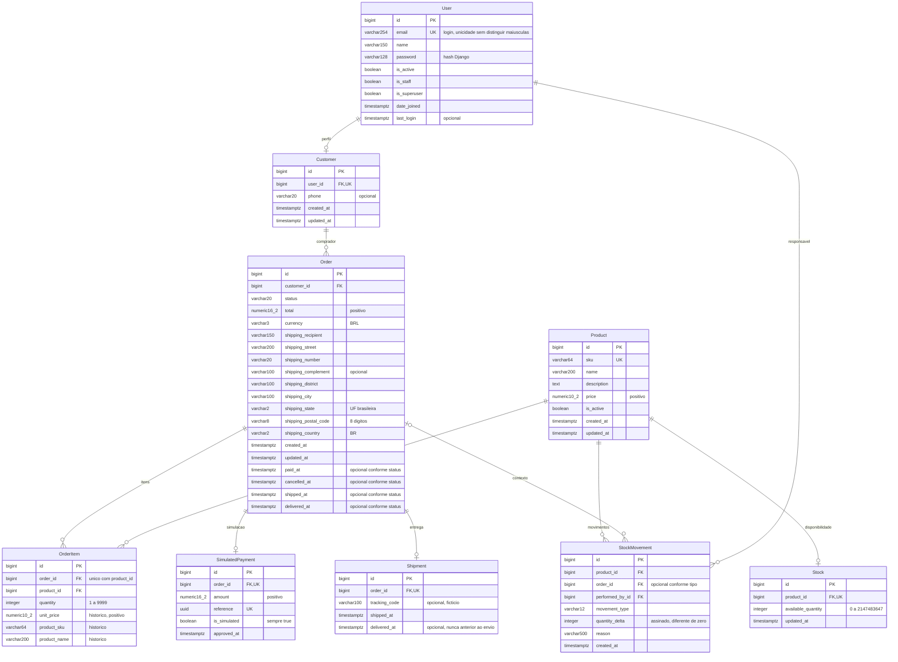

# Etapa 2 — Banco de dados

Status: implementada, verificada em PostgreSQL e aprovada em [revisão técnica](etapa-02-parecer.md). Consulte os [resultados e comandos](etapa-02-validacao.md) e o [pacote de revisão](etapa-02-revisao.md). A Etapa 3 só foi iniciada após esse parecer.

## Diagrama detalhado (definido antes dos modelos e migrations)

As cardinalidades mostram a garantia física: o banco garante **no máximo um** estoque por produto, mas não obriga um registro filho a existir. O mesmo vale para a existência de itens. A obrigação de criar estoque e pedidos com itens será dos serviços das etapas seguintes. As tabelas de grupos e permissões são fornecidas pelo Django e não aparecem no diagrama do domínio.

## Decisões da modelagem

- Usuário próprio desde `accounts.0001_initial`; credenciais, hash e permissões usam Django. Email é o login, com normalização e unicidade funcional por `Lower(email)` no banco.
- O índice único literal de email atende ao contrato de `USERNAME_FIELD` do Django; o índice funcional adicional impede duplicatas com diferenças de maiúsculas mesmo ao contornar o manager. Essa sobreposição é deliberada, sem índice comum adicional para o mesmo campo.
- Identificadores internos `BigAutoField`; a autorização futura deve conferir o dono, independentemente da previsibilidade do identificador.
- Dinheiro em `numeric`/`DecimalField`. Preço e unitário: 10 dígitos, 2 decimais, máximo `99999999.99`. Total e pagamento: 16 dígitos, 2 decimais, máximo `99999999999999.99`.
- Quantidade por item entre 1 e 9999. Limite futuro de 100 itens por pedido, aplicado pelo serviço, mantém o total máximo dentro da precisão escolhida. Estoque usa inteiro de 32 bits não negativo. Movimento usa variação assinada limitada ao intervalo simétrico de 32 bits.
- Campo inteiro estrito para impedir que o ORM trunque silenciosamente valores fracionários ou aceite booleanos como quantidades. Isso não dispensa validar a entrada na API futura nem controla SQL arbitrário.
- Endereço de compra fica em colunas do pedido, com país BR, UF válida e CEP com oito dígitos. Não há tabela de agenda de endereços nesta versão.
- `PROTECT` em relacionamentos de domínio: a exclusão pelo ORM falha quando quebraria referências históricas. Chaves estrangeiras também impedem registros órfãos por SQL direto. Isso não torna registros imutáveis nem bloqueia a exclusão direta de um registro folha: não haverá API de edição/exclusão de histórico.
- Não há signals para produzir estoque, pagamentos ou movimentos automaticamente. Os futuros serviços controlarão as operações e suas transações.
- `choices` documenta opções, mas não basta para proteger SQL direto; checks explícitos validam status, moeda e tipos.
- Datas com `USE_TZ=True`, banco em UTC e fuso de apresentação `America/Sao_Paulo`.
- Só há índices estruturais de PK, FK, unicidade e unicidade condicional. Otimizações adicionais dependem de medições na Etapa 9.

## Restrições locais e regras entre tabelas

O banco verificará saldo, quantidades, valores positivos e finitos dentro da precisão, SKU, valores enumerados, campos textuais essenciais não vazios, datas locais e duplicidades. Uma reserva por pedido/produto e uma liberação por pedido/produto terão unicidade condicional.

No pedido, datas obrigatórias dependem do estado: pendente não tem datas de avanço; cancelado tem só cancelamento; pago tem pagamento; enviado tem pagamento e envio; entregue tem pagamento, envio e entrega. Cada data deve respeitar a ordem dos eventos, inclusive não anteceder a criação.

Pagamento e entrega têm relações únicas com o pedido. Pagamento exige `is_simulated=True`. Entrega recebida não pode anteceder o envio. Movimentos exigem justificativa, responsável e sinal/contexto coerentes: entrada positiva sem pedido, ajuste não zero sem pedido, reserva negativa com pedido e liberação positiva com pedido.

Continuam dependendo dos serviços: total = soma dos itens; valor e data do pagamento = total e data do pedido; coerência de estado com pagamento e entrega; transições permitidas; autorização; preço histórico correto; não vender produto inativo; não reservar saldo indisponível; existência de itens e estoque; saldo = soma de movimentos. Não serão criados checks que consultem outras tabelas para tentar resolver essas regras.

Os modelos não executam as compras da Etapa 5 nem as transições da Etapa 6. Os testes desta etapa constroem registros diretamente para verificar o esquema. Nenhuma garantia de concorrência das operações de negócio será declarada antes dos testes dessas operações.

`save()` e `QuerySet.update()` não executam `full_clean()` automaticamente. O PostgreSQL verifica seus checks e tipos mesmo assim; formato completo de email e rejeição de dinheiro com casas decimais excedentes precisam de validação explícita de entrada/serviço. Uma coluna `numeric(..., 2)` pode arredondar SQL com casas extras: ela garante a representação armazenada, não a rejeição do formato originalmente enviado. A Etapa 4 também deverá executar os validadores de força de senha no cadastro; fazer hash, por si só, não aplica esses validadores.

## Verificação e revisão

Comandos, resultados, versões efetivamente instaladas e limitações estão na documentação de validação. A revisão deve distinguir falhas do escopo atual das funcionalidades planejadas para etapas posteriores.
