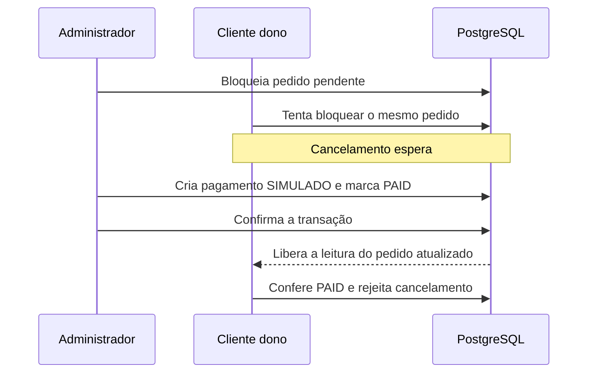

# Etapa 6 — Pagamento simulado, cancelamento, envio e entrega

Esta entrega implementa as quatro ações do ciclo de vida, com autorização, transações, bloqueio do pedido e verificação de histórico. **Todo pagamento é SIMULADO — SEM COBRANÇA REAL.** Não há gateway, cartão, operação bancária, estorno ou reembolso.

Criação de pedido já reservava estoque na Etapa 5. Pagar, enviar e entregar preservam esse saldo. Somente o cancelamento de um pedido pendente devolve a reserva. Não há expiração automática de reservas.

## Transições e repetições

| Ação | Quem executa | Primeira execução | Repetição válida |
| --- | --- | --- | --- |
| Confirmar pagamento simulado | Administrador | `PENDING_PAYMENT → PAID`; um pagamento com valor do pedido | Em `PAID`, `SHIPPED` ou `DELIVERED`, retorna o mesmo pagamento e o estado atual |
| Cancelar | Cliente dono | `PENDING_PAYMENT → CANCELLED`; devolve unidades e registra liberações | Em `CANCELLED`, retorna o pedido sem devolver novamente |
| Enviar | Administrador | `PAID → SHIPPED`; cria entrega com rastreamento opcional | Em `SHIPPED` ou `DELIVERED`, retorna a mesma entrega se o código for igual |
| Entregar | Administrador | `SHIPPED → DELIVERED`; atualiza a entrega existente | Em `DELIVERED`, retorna a mesma entrega e data |

Idempotência significa que repetir uma intenção já concluída não repete seus efeitos. As repetições preservam IDs, referências, valores, datas e `updated_at`. Confirmar pagamento novamente depois da entrega mantém `DELIVERED`; não retorna o pedido para `PAID`.

As permissões e a verificação de histórico também são executadas nas repetições. Administrador não recebe permissão de cancelamento nesta versão, mesmo se possuir um perfil `Customer`. Cancelamento de pedido pago, envio de pendente e entrega sem envio são rejeitados. Pedidos cancelados não recebem pagamento, envio ou entrega.

## Contrato HTTP

Todas as ações usam token JWT e `Content-Type: application/json`. As respostas tratadas usam `Cache-Control: no-store`, pois incluem dados do pedido/endereço.

| Método e rota | Corpo |
| --- | --- |
| `POST /api/orders/{id}/simulated-payment/` | `{}` |
| `POST /api/orders/{id}/cancel/` | `{}` |
| `POST /api/orders/{id}/ship/` | `{}` ou `{"tracking_code": "SIMULATED-001"}` |
| `POST /api/orders/{id}/deliver/` | `{}` |

Rastreamento é texto opcional, até 100 caracteres, com espaços nas bordas removidos. O padrão é vazio. Caracteres nulos, Unicode inválido e tipos diferentes de texto são rejeitados. Para repetir um envio com código preenchido, envie novamente o mesmo código normalizado; omiti-lo significa código vazio e gera conflito se o envio original usou outro valor. O código é fictício e não integra transportadoras.

O corpo não aceita valor de pagamento, referência, indicador de simulação, dono, estado ou datas. Campos desconhecidos também são rejeitados. O valor vem de `Order.total`, que foi calculado na criação com preços históricos; o cliente não escolhe quanto “pagar”. `is_simulated` é definido como verdadeiro pelo servidor e reforçado no PostgreSQL.

Todas as ações bem-sucedidas, iniciais ou repetidas, retornam **200**, com este envelope:

```json
{
  "order": {"id": 1, "status": "PAID", "total": "77.70", "payment_mode": "SIMULATED_NO_REAL_CHARGE"},
  "simulated_payment": {"id": 1, "amount": "77.70", "reference": "UUID", "approved_at": "data com fuso", "is_simulated": true},
  "shipment": null
}
```

Esse é um recorte ilustrativo: `order` contém os demais campos da resposta de criação, incluindo endereço, itens e datas. `simulated_payment` e `shipment` são nulos quando não existem naquele estado. Entrega contém ID, rastreamento e datas de envio/recebimento. Valores monetários continuam como strings com duas casas decimais; datas têm fuso.

| Situação | HTTP / código de conflito |
| --- | --- |
| Entrada inválida ou campo proibido | 400 |
| Token ausente, inválido, expirado ou conta desativada | 401 |
| Conta autenticada sem o papel exigido | 403 |
| Pedido inexistente; cancelamento de pedido alheio | 404, com a mesma mensagem |
| Transição proibida | 409 / `invalid_transition` |
| Código diferente em repetição de envio | 409 / `tracking_conflict` |
| Histórico incompatível entre tabelas | 409 / `order_integrity_conflict` |
| Devolução ultrapassa o limite inteiro de estoque | 409 / `stock_capacity_exceeded` |
| Método não implementado | 405 |
| Conteúdo diferente de JSON | 415 |

A criação continua em `POST /api/orders/`. Consulta/listagem, catálogo, gestão administrativa de estoque, filtros e OpenAPI continuam na Etapa 7. A autorização das ações aqui entregues já é testada nas rotas reais; o critério de consulta de pedidos de outro cliente ainda dependerá dos endpoints de leitura.

## Transação e concorrência

O serviço confere o papel atual no banco e bloqueia o pedido com `select_for_update()` antes de ler histórico, conferir estado ou gravar. No cancelamento, a busca já filtra pelo cliente autenticado, preservando a mesma resposta para pedido alheio ou inexistente.

Pagamento, envio e entrega mantêm o bloqueio do pedido durante toda a operação. Cancelamento adquire **pedido → produtos em ID crescente → estoques em ID crescente de produto**. Bloquear produtos antes do estoque também evita inverter a ordem ao criar liberações que referenciam produtos por chave estrangeira. A atividade atual do produto não impede cancelar uma compra antiga.

Cada ação usa `transaction.atomic()`. Pagamento e mudança de estado persistem juntos; envio/entrega e suas datas no pedido também. Cancelamento reúne saldos, movimentos e estado. Falhar na última gravação desfaz inclusive as anteriores.

Exemplo: quando pagamento vence a disputa com cancelamento, o cancelamento espera e depois encontra `PAID`, sendo rejeitado. Se cancelamento vencer, o pagamento encontra `CANCELLED` e não cria cobrança simulada.



O isolamento permanece READ COMMITTED. A ordem consistente reduz risco de deadlocks; escritores externos que ignorem o protocolo continuam fora dessa garantia. Não há retry automático nem promessa de ausência absoluta de deadlocks.

## Integridade do histórico

`orders/integrity.py` valida o contexto do pedido enquanto seu bloqueio está mantido:

- Há de 1 a 100 itens e o total corresponde à soma dos preços históricos multiplicados pelas quantidades.
- Cada produto tem exatamente a reserva esperada, com quantidade, responsável e data compatíveis com a criação.
- Liberações só aparecem em pedidos cancelados, correspondem aos itens e são atribuídas ao dono, com data compatível com o cancelamento.
- Estados pagos exigem pagamento simulado único, valor igual ao total e aprovação na mesma data registrada no pedido.
- Estados enviados/entregues exigem entrega com datas iguais às do pedido; estados anteriores e cancelados não podem ter entrega.

As restrições locais e de unicidade continuam no banco. A verificação entre tabelas fica no serviço; não foi criado um CHECK que consulte outras tabelas. A conciliação entre saldo e soma global dos movimentos é conferida nos cenários de teste.

Se faltar pagamento de um pedido pago, uma repetição não cria outro para encobrir a divergência. Se faltar liberação de um cancelado, o serviço não devolve estoque novamente. A resposta HTTP apresenta conflito genérico; a exceção mantém um motivo interno para diagnóstico, sem expô-lo na API. Erros inesperados de banco continuam sendo falhas, com rollback, e não são disfarçados de conflito de negócio.

Uma devolução pode superar o limite técnico do estoque se outra entrada já tiver preenchido o saldo disponível. O serviço verifica **todos** os saldos antes de alterá-los. Acima de `2147483647`, rejeita com `stock_capacity_exceeded`, preservando pedido, unidades e movimentos; não trunca nem descarta quantidade. O tratamento administrativo do saldo pertence ao fluxo de estoque posterior.

## Resposta coerente sob concorrência

`OrderTransitionResult` reúne pedido, pagamento e entrega lidos/escritos sob o mesmo bloqueio. A apresentação não faz uma nova busca desses relacionamentos depois do commit para compor o envelope. Isso evita misturar um pedido `SHIPPED` com uma data de entrega gravada por outra chamada logo depois.

A resposta representa o estado observado pela operação. Uma entrega concorrente posterior pode avançar o banco, mantendo coerente a resposta do envio que acabou de concluir. Os itens/endereço permanecem imutáveis conforme o domínio. Há teste que serializa o resultado de envio depois de outra ação entregar e confere que ele continua consistente.

## Gerador e execução local

O gerador agora usa os serviços de criação, pagamento simulado, cancelamento, envio e entrega. Apenas datas e referências da demonstração são reposicionadas para valores fictícios fixos dentro da transação externa do gerador; esse caminho não é exposto na API. As aberturas de estoque continuam sendo preparação da fixture, até existir a gestão de estoque da Etapa 7.

Permanecem os cinco estados e os valores conhecidos: 5 pedidos, 7 itens, 3 pagamentos simulados, 2 entregas, 11 movimentos e saldos 26/17/45. A reprodutibilidade agora compara também endereço, itens, entregas, movimentos e datas de atualização de estoque. Uma falha provocada no envio desfaz todo o dataset. O seed não foi repetido sobre o volume principal já preenchido.

Para reproduzir, crie um pedido conforme a Etapa 5 e substitua o ID/token nos comandos. Use token de administrador nas ações administrativas e token do cliente dono no cancelamento:

```bash
curl --request POST http://127.0.0.1:18003/api/orders/ID/simulated-payment/ \
  --header 'Content-Type: application/json' --header 'Authorization: Bearer TOKEN_ADMIN' --data '{}'
curl --request POST http://127.0.0.1:18003/api/orders/ID/ship/ \
  --header 'Content-Type: application/json' --header 'Authorization: Bearer TOKEN_ADMIN' \
  --data '{"tracking_code":"SIMULATED-001"}'
curl --request POST http://127.0.0.1:18003/api/orders/ID/deliver/ \
  --header 'Content-Type: application/json' --header 'Authorization: Bearer TOKEN_ADMIN' --data '{}'
```

O cancelamento deve ser demonstrado em **outro pedido ainda pendente**:

```bash
curl --request POST http://127.0.0.1:18003/api/orders/ID_PENDENTE/cancel/ \
  --header 'Content-Type: application/json' --header 'Authorization: Bearer TOKEN_CLIENTE' --data '{}'
```

A porta 18003 é a do ambiente já preparado neste computador. O Compose padrão usa 8000. Repetir os comandos válidos permite conferir as referências/datas e os efeitos de idempotência. Tudo é local; nenhum envio ao GitHub, publicação ou deploy foi realizado.

## Verificação desta entrega

Foram adicionados **43 testes**: 21 de ações/HTTP/rollback/permissões, 10 de integridade, 11 de concorrência e 1 do gerador. A suíte completa tem **152 testes**, aprovados no PostgreSQL local e no Docker Linux ARM64. O helper de sincronização foi compartilhado com os sete testes concorrentes da Etapa 5, que continuam passando.

As onze disputas novas cobrem pagamento contra cancelamento nos dois sentidos; pagamento, cancelamento, envio e entrega duplicados; envio seguido de entrega aguardando; rastreamentos conflitantes; cancelamento com compra aguardando; rollback de cancelamento com pagamento aguardando; e dois cancelamentos de múltiplos produtos. Cada cenário observa PIDs distintos e `pg_blocking_pids` antes de liberar a primeira transação, com limites de tempo.

O teste HTTP isolado percorreu criação, pagamento simulado, envio e entrega; as repetições preservaram o snapshot e o saldo ficou `26 → 23`, sem segundo desconto. Outro pedido de `51.80` reservou duas unidades e foi cancelado, com saldo `23 → 21 → 23` e uma liberação `+2`. Campos protegidos, acesso alheio e transições inválidas foram rejeitados. Banco/container temporários foram removidos; o snapshot das nove entidades do dataset principal permaneceu igual.

Consulte as [evidências reais](etapa-06-evidencias.txt) e o [pacote de revisão](etapa-06-revisao.md). Não houve medição de desempenho, validação de outras arquiteturas ou configuração de CI nesta etapa. A Etapa 7 não foi iniciada.

Referências oficiais: [select_for_update no Django 5.2](https://docs.djangoproject.com/en/5.2/ref/models/querysets/#select-for-update) e [bloqueios do PostgreSQL 17](https://www.postgresql.org/docs/17/explicit-locking.html). O projeto mantém as versões e dependências da etapa anterior, sem instalação adicional.
